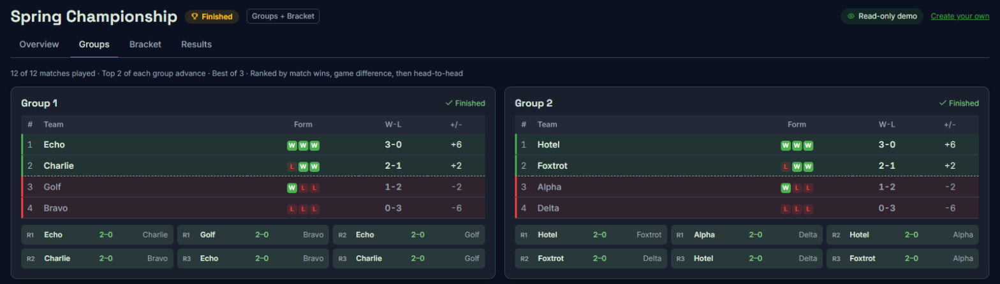
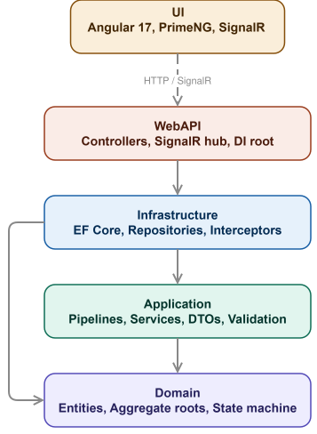
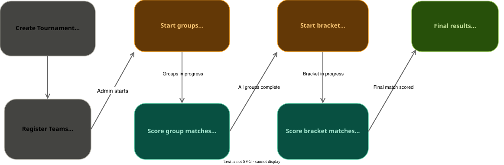

# TO2 — Tournament Organizer

A full-stack web application for organizing team tournaments with group stages, single-elimination brackets, or both, with real-time updates for everyone following a tournament.

**.NET 8 · ASP.NET Core · EF Core · PostgreSQL · SignalR · Angular 22 · xUnit**

---

## Features

- **Three formats** — round-robin groups, a single-elimination bracket, or groups followed by a bracket; 4 to 32 teams, every match best of 3.
- **Live scoring** — a score in progress is visible to everyone watching the tournament; confirming it updates tables, brackets and status on every open page.
- **Automatic standings** — group tables ranked by match wins, game difference and head-to-head.
- **Bracket seeding** — group winners meet runners-up, teams from the same group are kept apart in the first round, and uneven team counts are filled with BYEs.
- **Final placements** — shared ranks for teams knocked out in the same round.
- **Organizations** — each organization sees only its own tournaments; members join with an invite code.

## Architecture

Clean Architecture with four layers (Domain, Application, Infrastructure, WebAPI), dependencies pointing inward.

- **Pipelines** — multi-step workflows such as confirming a match result or starting a bracket run as ordered steps in one transaction, so a failure leaves nothing half-saved.
- **State machine** — the tournament lifecycle and which actions are allowed in each state are defined once in the domain and exposed to the UI.
- **Multi-tenancy** — tenant isolation through EF Core query filters and save interceptors, without tenant logic in business code.
- **Optimistic concurrency** — two organizers changing the same data at once get a conflict instead of overwriting each other.
- **Authentication** — ASP.NET Core Identity with JWT access tokens and rotated, hashed refresh tokens.

## Tournament Lifecycle

## Tests

Integration tests run the real database context and pipelines; a property-based test plays randomly generated tournaments of every format to the end and checks the results; PostgreSQL tests run against a real database in a container; the Angular UI has its own unit tests.
