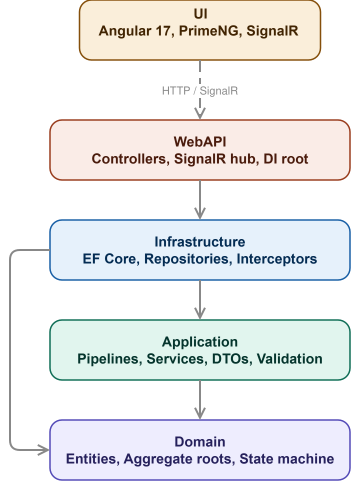

# TO2 — Tournament Organizer

Full-stack tournament management application supporting group stages, single-elimination brackets, and combined formats for 4–32 teams. Real-time updates, multi-tenant isolation, JWT authentication.

**.NET 8 Web API · Angular 22 · PrimeNG 22 · PostgreSQL · SignalR · xUnit · FluentAssertions · Vitest**

---

<!-- TODO: Screenshot or GIF of the tournament configurator -->

## Tournament Formats

Tournaments are sized for 4–32 teams (a tournament can start with as few as 2 registered teams). Matches are best-of-3.

- **BracketOnly** — Single-elimination bracket. Teams randomly seeded.
- **GroupsOnly** — Round-robin groups. Final placements from group standings.
- **GroupsAndBracket** — Round-robin groups into a seeded bracket. Configurable advancement slots per group. Unequal group sizes supported.

## Architecture



## Tournament Lifecycle

```
Setup → SeedingGroups → GroupsInProgress → GroupsCompleted → SeedingBracket → BracketInProgress → Finished
```

Each format uses its own subset (BracketOnly skips the group states, GroupsOnly finishes after the groups).

- **Delete** — only in `Setup`. Removes the tournament and teams that are in no other tournament.
- **Cancel** — any started state before `Finished`. Final (no un-cancel); records who/when/optional reason. Played data stays viewable, scoring is blocked.
- `Finished` and `Cancelled` are terminal.

## Technical Decisions

**Pipeline pattern.** Confirming a match result can cascade into group stats, standing updates, state transitions, and placement calculation. `MatchResultPipeline` writes the match's games and winner, then runs 4 sequential steps with a shared context in one transaction that rolls back on failure.

**Live scoring.** A match is scored as a draft (− / + per team) that every open page of that tournament sees live through SignalR. The hub keeps the latest draft per match in memory, so a page that opens, refreshes or reconnects later still sees it. Confirm saves the whole result in one request with the match version.

**State machine in the domain layer.** Tournament lifecycle rules are enforced by `TournamentStateMachine` with explicit transition dictionaries and format-specific overloads. Pipelines validate every stage transition with `ValidateTransition()`; which user actions are allowed per state (`CanScoreMatches`, `CanCancel`, `CanDelete`, …) is also decided there and exposed to the UI, so the frontend never re-implements status rules.

**EF Core interceptors.** `TenantId` and audit fields (`CreatedBy/Date`, `LastModifiedBy/Date`, declared on `EntityBase`) are filled in by `SaveChangesInterceptor` implementations, and global query filters scope every read to the current tenant. Business code never sets them manually.

**BYE system.** Brackets accept non-power-of-two team counts by padding to the next power of two and auto-resolving BYE matches. An organizer can run 11 teams through 3 groups and advance 6 into an 8-slot bracket without workarounds.

**Single SaveChanges per request.** The pipeline mutates entities in memory across multiple steps; `UnitOfWork` commits once at the end. If any step fails, nothing is persisted.

**Optimistic concurrency (app-managed, provider-agnostic).** Every entity has a `Version` concurrency token that an EF interceptor increments on each update. EF checks the loaded version in the `UPDATE`/`DELETE` `WHERE` clause, so a write that lost a race fails with 409 instead of silently overwriting. Tournament updates and match results carry the `Version` the client loaded; a stale one is rejected with 409, so one admin can't silently overwrite another's result. No database-specific row-version feature is used.

## Running Locally

**Prerequisites:** .NET 8 SDK, Node.js 22.22+ (or 24.15+), Docker

```bash
# Start PostgreSQL
cd src/webAPI
docker compose up -d

# Backend
dotnet restore
cd ../Infrastructure
dotnet ef database update --startup-project ../webAPI
cd ../webAPI
dotnet run

# Frontend (separate terminal)
cd src/UI
npm install
npm start
```

Backend: `http://localhost:5161` (`dotnet run --launch-profile https` adds `https://localhost:7221`) — Frontend: `http://localhost:4200` (dev build calls `http://localhost:5161/api`). Optional env `PRIMENG_LICENSE` for the PrimeNG license key (empty = license notice).
